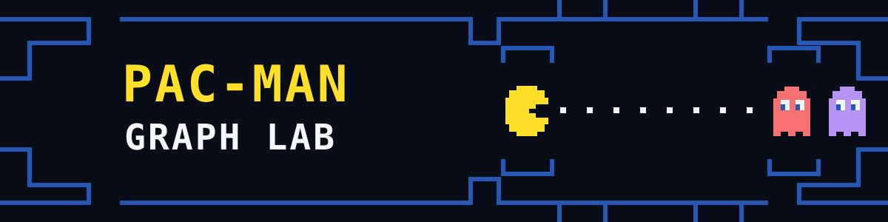

<p align="center">
  
</p>

<p align="center">Visualização e análise experimental de algoritmos em grafos ponderados e direcionados.</p>

<p align="center">
  <a href="https://marloncarvalhodev.github.io/Pac-Man/"></a>
</p>

---

## Modos de Operação

A página **Arcade** (`PlayPage`) suporta três modos de execução sobre o mesmo motor (`GameScene`):

- **Modo Humano (`HUMAN`)**: Controle direto via teclado (`WASD` ou `Setas`, `P` para pausar) ou controles táteis em dispositivos móveis. Os fantasmas possuem carência inicial de `2000 ms` antes de iniciar a perseguição.
- **Modo Demonstração (`DEMO`)**: O agente autônomo executa o planejamento de rotas sem perseguição ativa dos fantasmas, permitindo observar a coleta de chaves, o desvio de terrenos custosos e o uso de portais.
- **Modo Máquina vs. Máquina (`MVM`)**: O agente autônomo enfrenta dois fantasmas ativos em tempo real (Perseguidor e Interceptor), com carência inicial de `500 ms` e replanejamento dinâmico diante de ameaças.

---

## Estratégias Autônomas

O módulo `web/src/game/agents/strategies/` implementa seis estratégias selecionáveis no Arcade e comparáveis na Arena Experimental:

| Estratégia | Objetivo Principal | Comportamento e Limitações |
| :--- | :--- | :--- |
| `MIN_COST` | Menor custo ponderado | Minimiza o somatório dos pesos das arestas até o objetivo atual. |
| `MIN_TIME` | Menor tempo de percurso | Minimiza o tempo físico de travessia (`peso × PLAYER_BASE_DELAY_MS`). Como o atraso base é constante (`200 ms`), `MIN_TIME` e `MIN_COST` são **matematicamente equivalentes**, produzindo custos e rotas idênticos. |
| `SURVIVAL` | Sobrevivência com fuga ativa | Prioriza rotas seguras afastadas dos fantasmas, aceitando desvios maiores para evitar captura. |
| `MAX_SURVIVAL_TIME` | Permanência máxima | Busca maximizar o tempo de sobrevivência no labirinto até o limite temporal da partida (`TIMEOUT`). |
| `MAX_SCORE` | Maior pontuação | Pondera a coleta de Pac-Dots e Power Pellets para maximizar a pontuação, buscando fantasmas vulneráveis durante o modo *Frightened*. |
| `FULL_CLEAR` | Coleta completa | Planeja a coleta integral dos itens disponíveis antes de seguir para a saída. |

> **Nota sobre otimalidade:** As estratégias baseadas em heurísticas e tomada de decisão reativa em ambiente dinâmico não garantem otimalidade global nem vitória determinística em `MVM`, especialmente sob pressão simultânea dos dois fantasmas ou presença de terrenos de alto custo (Lama e Lava).

---

## Fundamentação Matemática

O labirinto (`25 × 25`) é modelado como um grafo ponderado e direcionado `G = (V, E)`:

- **Geração e Conectividade (DFS)**: `MazeGenerator` utiliza Busca em Profundidade (DFS) determinística a partir de uma semente numérica para gerar o labirinto, garantindo conectividade, rotas alternativas próximas ao spawn e distância inicial segura dos fantasmas.
- **Pesos de Terreno**: Cada célula transitável possui um multiplicador de custo (`NORMAL = 1.0`, `BOOST = 0.3`, `MUD = 4.0`, `LAVA = 8.0` com dano de `-10 HP` por entrada).
- **Dijkstra (`dijkstra.ts`)**: Explora o grafo em ordem crescente de custo acumulado real `g(n)`, garantindo o caminho de menor custo entre dois vértices.
- **A\* (`aStar.ts`)**: Combina o custo real `g(n)` com uma heurística admissível `h(n)` (distância de Manhattan ponderada pelo menor custo possível de terreno), reduzindo expansões sem perder admissibilidade.
- **Portais**: Pares de vértices conectados por arestas de teleporte instantâneo com custo definido, considerados diretamente nos algoritmos de busca.
- **Múltiplos Objetivos**: Quando há múltiplas chaves restantes, o agente avalia a sequência de coleta por aproximação gulosa/combinada antes de seguir para a saída.

---

## Inteligência dos Agentes e Prevenção de Oscilações

- **Perseguidor (Fantasma Vermelho)**: Calcula a rota mínima diretamente até a posição atual do Pac-Man (`playerPos`).
- **Interceptor (Fantasma Roxo)**: Implementado em `GhostInterception.ts`, projeta a trajetória provável do jogador (`getPacmanProbablePath`) e calcula distâncias ponderadas (`computeDistancesFrom`) para escolher um ponto de interceptação à frente, recorrendo à perseguição ativa quando não há candidato competitivo ou ao atingir o alvo sem encontrar o jogador.
- **Avaliação de Risco (`RiskAssessment.ts`)**: Avalia a proximidade ponderada dos fantasmas, penalizando becos sem saída e priorizando bifurcações e rotas de fuga futuras.
- **Histerese e Anti-Oscilação (`AutonomousAgent.ts`)**:
  - Exige permanência mínima de `600 ms` no estado `ESCAPING` e margem de segurança de `+2.5` antes de retomar `COLLECTING`.
  - Mantém memória dos últimos `6` vértices visitados durante a fuga, aplicando penalidade (`-45`) a revisitas para evitar vai-e-vem e travessias repetitivas de portais.

---

## Laboratório de Grafos

A página **Laboratório** (`LaboratoryPage` + `GraphLabScene`) permite inspecionar o funcionamento interno dos algoritmos:

- **Modos de visualização**: `Labirinto`, `Grafo` (vértices e arestas ponderadas) e `Sobreposição`.
- **Execução controlada**: Controles de `Executar`/`Pausar`, `Próximo passo`, `Reiniciar`, velocidade ajustável e contador de passos (`atual / total`).
- **Análise sob demanda**: Comparação direta entre **Dijkstra** e **A\*** (custo, nós expandidos e ganho percentual), inspeção individual de vértices por clique ou coordenadas `(linha, coluna)` e painel conceitual de ajuda.

---

## Arena Experimental

A página **Arena** (`ArenaPage` + `Experiment.ts`) executa baterias experimentais em segundo plano via Web Worker (`experiment.worker.ts`):

- **Reprodutibilidade**: Execuções determinísticas controladas por sementes (`seeds`) e repetições configuráveis.
- **Métricas coletadas**: Desfecho (`WON`, `LOST`, `TIMEOUT`, `BLOCKED`), custo percorrido, movimentos, nós expandidos, Pac-Dots, chaves, tempo simulado (invariante à velocidade de visualização) e tempo real.
- **Ranking e Gráficos**: Consolidação comparativa entre as estratégias com cálculo de medianas e visualização gráfica (`ExperimentCharts`).

---

## Manual e Teoria

A página **Manual** (`HowToPlayPage`) documenta as regras do jogo, controles, terrenos, comportamento dos fantasmas e os fundamentos teóricos de grafos aplicados no projeto.

---

## Arquitetura e Estrutura de Diretórios

```text
Pac-Man/
├── README.md
├── INTERFACE_E_VALIDACAO.md
└── web/
    ├── package.json
    ├── index.html
    └── src/
        ├── app/            # Shell da aplicação, roteamento e layout principal (App.tsx)
        ├── assets/         # Assets estáticos (ex.: pacs.jpeg)
        ├── components/     # HUD do jogo, controles do laboratório, gráficos e sidebar (StaggeredMenu)
        ├── game/
        │   ├── agents/     # AutonomousAgent, RiskAssessment, GhostInterception e strategies/
        │   ├── algorithms/ # Dijkstra, A* e tipos de pathfinding
        │   ├── config/     # GAME_SPEED_CONFIG e MatchRules
        │   ├── core/       # EventBus e GameState
        │   ├── experiment/ # Motor experimental (Experiment.ts), worker e agregação de resultados
        │   ├── graph/      # Graph, MazeGenerator e Terrain
        │   ├── rendering/  # Renderização de personagens
        │   └── scenes/     # GameScene e GraphLabScene (Phaser 3)
        ├── pages/          # HomePage, PlayPage, LaboratoryPage, ArenaPage e HowToPlayPage
        ├── styles/         # Tokens e estilos globais
        └── tests/          # Suíte de testes automatizados (Vitest)
```

---

## Tecnologias, Instalação e Comandos

- **Stack**: React 18, TypeScript 5, Phaser 3.88, Vite 6, Vitest 3 e Lucide React.

```bash
cd web
npm install
```

| Comando | Finalidade |
| :--- | :--- |
| `npm run dev` | Inicia o servidor de desenvolvimento Vite |
| `npm run build` | Executa verificação TypeScript (`tsc`) e gera o build de produção (`vite build`) |
| `npm run preview` | Pré-visualiza localmente o build de produção |
| `npm test` | Executa a suíte de testes automatizados (`vitest run`) |

---

## Limitações e Documentação Complementar

- As estratégias heurísticas operam sobre decisões locais/temporais e não garantem vitória em todas as sementes no modo `MVM`.
- Documentação adicional de validação encontra-se em [INTERFACE_E_VALIDACAO.md](INTERFACE_E_VALIDACAO.md).

---

## Contexto Acadêmico

Projeto desenvolvido para a disciplina de **Teoria dos Grafos**, integrando visualização interativa, simulação em tempo real e experimentação comparativa de algoritmos de busca.
